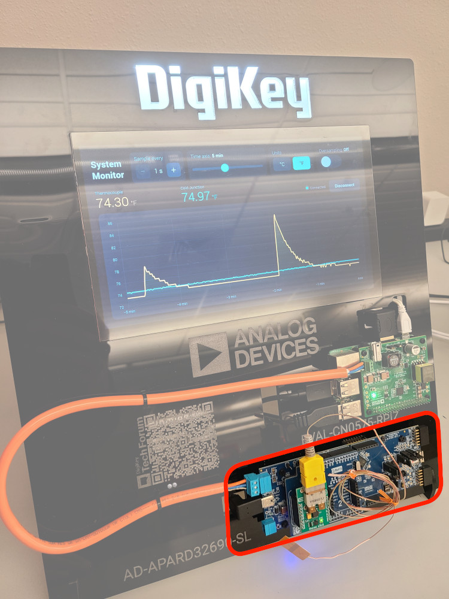

# Industrial Sensor Component of the Analog Devices 10BASE-T1L Demo

Within [ADI's CodeFusion Studio extension for VS Code](https://www.analog.com/en/resources/evaluation-hardware-and-software/embedded-development-software/codefusion-studio.html), the source code was developed for this Single Pair Ethernet (SPE) connected sensor composed of the AD-APARD32690-SL and the THERMO Click add-on board (highlighted in the Figure below). Please see [From Sensor to Server: Temperature Monitoring over 10BASE-T1L with Analog Devices](https://forum.digikey.com/t/from-sensor-to-server-temperature-monitoring-over-10base-t1l-with-analog-devices/72604) for a comprehensive description of the parent demo project. The sensor component periodically collects samples from the K-type thermocouple and sends them to the [HMI](https://github.com/eewiki/adi-cn0575-hmi-demo/tree/master) over the 10BASE-T1L Ethernet connection. It also accepts a small set of commands allowing external applications to modify the sensor's behavior. 

Please install VS Code, the CodeFusion Studio extension, and the ADI MSDK in order import, build, and flash this application. 
